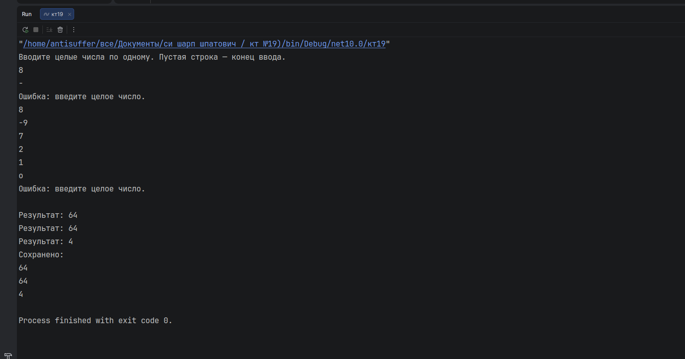

# КТ №19 — Делегаты и лямбда-выражения

В репозитории оба варианта задания, каждый — отдельный проект в своей папке.

## Вариант 1 — Обработка чисел (`number_processing`)

- `List<int> numbers` с произвольным набором положительных и отрицательных чисел.
- Лямбда-фильтр `Func<int, bool>`: оставляет только чётные числа.
- Лямбда-преобразование `Func<int, int>`: возводит число в квадрат.
- Лямбда-действие `Action<int>`: выводит результат на экран и сохраняет его в отдельный список.
- Конвейер: для каждого чётного числа вычислить квадрат и выполнить действие с результатом.

### Проверочные ключи

| Ввод | Ожидаемый результат |
|---|---|
| `1`, `2`, `3`, `4`, `5`, `6` | `Результат четного числа в квадрате : 4`, `16`, `36`; в списке `Сохранено:` три числа — 4, 16, 36 |
| `-9`, `7`, `1` | ничего не выводится: нечётные числа отфильтрованы |
| `abc` | `Ошибка: введите целое число.` |
| `10001` | `Ошибка: число не должно быть больше 10000.` |
| пустая строка | конец ввода, вывод списка `Сохранено:` |

## Вариант 2 — Обработка сообщений (`message_processing`)

- `List<string> messages` с произвольным набором строк.
- Лямбда-фильтр `Func<string, bool>`: оставляет только сообщения длиннее 3 символов.
- Лямбда-преобразование `Func<string, string>`: переводит сообщение в верхний регистр и добавляет префикс `[LOG] `.
- Лямбда-действие `Action<string>`: выводит результат на экран и сохраняет его в отдельный список.
- Конвейер: для каждого длинного сообщения выполнить преобразование и действие с результатом.

### Проверочные ключи

| Ввод | Ожидаемый результат |
|---|---|
| `hi`, `привет`, `ok`, `до свидания` | `[LOG] ПРИВЕТ`, `[LOG] ДО СВИДАНИЯ`; в списке `Сохранено:` два сообщения |
| `hi`, `ok` | ничего не выводится: короткие сообщения отфильтрованы |
| пустая строка | конец ввода, вывод списка `Сохранено:` |

## Запуск

```
dotnet run --project number_processing
dotnet run --project message_processing
```

## Результат выполнения (вариант 1)


